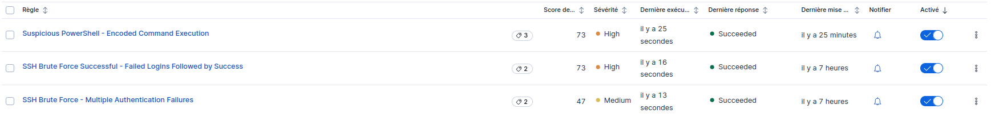
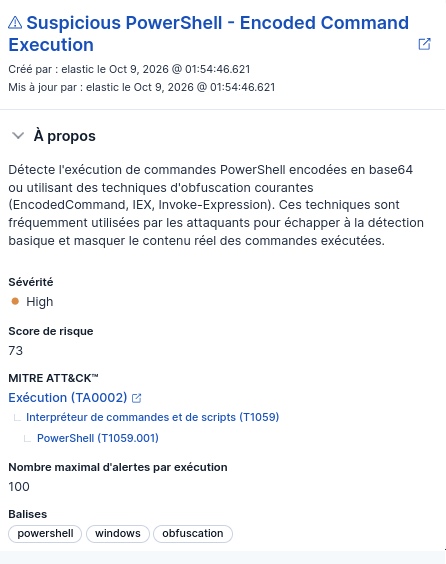
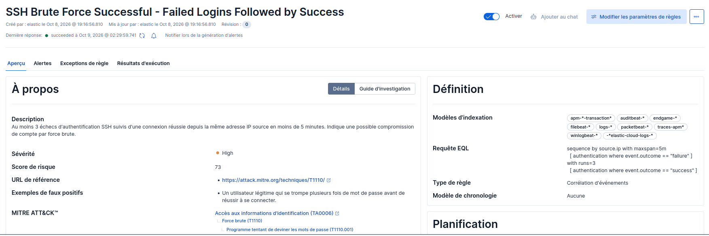
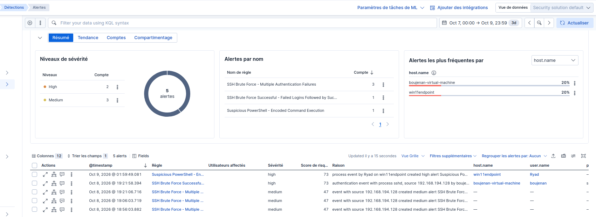
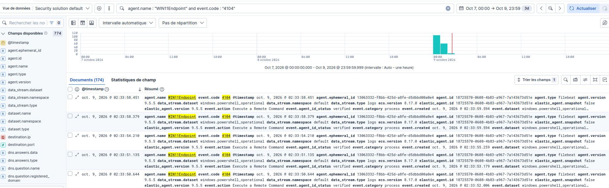

# Elastic Security — Lab SOC : Détection SSH Brute Force & PowerShell Malveillant

Lab de détection construit sur Elastic Stack (Elasticsearch, Kibana, Elastic Agent/Fleet), simulant un environnement SOC avec collecte de logs multi-OS, règles de détection personnalisées mappées MITRE ATT&CK, et investigation d'alertes.

## Architecture

- **Serveur Elastic Stack** : Ubuntu Server (Elasticsearch 9.5.5, Kibana 9.5.5, Fleet Server)
- **Endpoint Linux** : Ubuntu (agent Elastic enrôlé), logs collectés via `/var/log/auth.log` et syslog
- **Endpoint Windows** : Windows 11 Pro (agent Elastic enrôlé), PowerShell Script Block Logging + Sysmon (config SwiftOnSecurity)
- **Cible d'attaque** : Metasploitable 2 (hébergeant les scénarios de brute force)
- Réseau isolé VMware, sous-réseau `192.168.194.0/24`

## Installation (résumé)

1. Déploiement Elasticsearch + Kibana avec TLS et authentification
2. Installation Fleet Server sur le serveur Ubuntu
3. Enrôlement de l'endpoint Linux via l'intégration **System** (collecte auth.log/syslog)
4. Sur l'endpoint Windows :
   - Activation du **PowerShell Script Block Logging** et **Module Logging** via stratégie de groupe locale (`gpedit.msc`)
   - Installation de **Sysmon** avec la configuration communautaire SwiftOnSecurity
   - Enrôlement via l'intégration **Windows** (canaux PowerShell Operational + Sysmon Operational)

## Règles de détection

### 1. SSH Brute Force - Multiple Authentication Failures
- **Type** : Threshold (KQL)
- **Requête** : `event.category : "authentication" and event.outcome : "failure"`
- **Seuil** : ≥ 5 échecs par IP source, fenêtre de 5 minutes
- **Sévérité** : Medium (score 47)
- **MITRE ATT&CK** : TA0006 (Credential Access) → T1110 (Brute Force) → T1110.001 (Password Guessing)
- **Résultat** : 3 alertes Medium générées (9 échecs/IP)

### 2. SSH Brute Force Successful - Failed Logins Followed by Success
- **Type** : EQL (corrélation d'événements)
- **Requête** :
- **Sévérité** : High (score 73)
- **MITRE ATT&CK** : TA0006 → T1110 → T1110.001
- **Résultat** : 1 alerte High générée (séquence 4 échecs + 1 succès corrélés sur la même IP)

### 3. Suspicious PowerShell - Encoded Command Execution
- **Type** : Custom query (KQL)
- **Requête** : `event.code : "4104" and powershell.file.script_block_text : (*EncodedCommand* or *-enc* or *FromBase64String* or *IEX* or *Invoke-Expression*)`
- **Sévérité** : High (score 73)
- **MITRE ATT&CK** : TA0002 (Execution) → T1059 (Command and Scripting Interpreter) → T1059.001 (PowerShell)
- **Détail** : détecte les commandes PowerShell obfusquées/encodées en base64, technique courante d'évasion utilisée par les attaquants. Le Script Block Logging déchiffre et journalise le contenu réel de la commande malgré l'encodage, permettant la détection.
- **Résultat** : 1 alerte High générée

## Scénarios d'attaque simulés

1. **Brute force SSH** : tentatives de connexion répétées avec identifiants incorrects depuis une IP source, suivies d'une connexion réussie (simulation d'une attaque par dictionnaire aboutie)
2. **Exécution PowerShell encodée** : commande PowerShell encodée en base64 via `-EncodedCommand`, simulant une technique d'obfuscation utilisée pour échapper aux outils de détection basiques

## Processus d'investigation

Pour chaque alerte :
1. Identification de la source (IP, hostname, utilisateur)
2. Analyse du contenu de l'événement déclencheur (commande exécutée, tentatives échouées)
3. Vérification du contexte via les logs complémentaires (Sysmon pour la chaîne de processus côté Windows, auth.log pour la séquence complète côté Linux)
4. Décodage et analyse de la commande PowerShell réelle (cas de la commande encodée)
5. Évaluation de faux positifs potentiels (documentée dans chaque règle)

## Limites du lab

- Environnement isolé (réseau VMware privé), pas de volumétrie réelle de production
- Règles simples (seuils fixes), pas de détection comportementale avancée (UEBA)
- Pas de réponse automatisée (SOAR) : investigation manuelle uniquement
- Certificats TLS auto-signés (déconseillé en production)

## Pistes d'amélioration

- Ajout d'un scénario Active Directory / Windows Server
- Intégration d'un SOAR pour réponse automatisée
- Règles de détection comportementale (New Terms, Machine Learning)
- Dashboards personnalisés pour vue d'ensemble SOC

---

**Auteur** : Ryad Boujenan — Élève ingénieur Cybersécurité/SOC, EMSI Casablanca
## Captures d'écran

**Règles de détection configurées**

**Alerte High - PowerShell encodé**

**Règle EQL - Corrélation brute force SSH**

**Vue d'ensemble des alertes générées**

**Logs PowerShell déchiffrés dans Discover**

