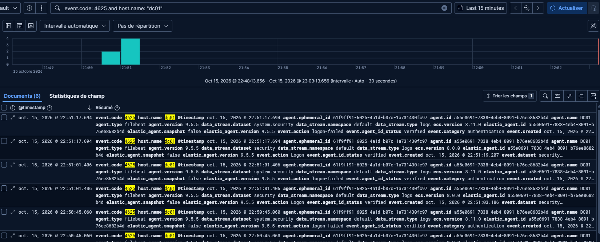
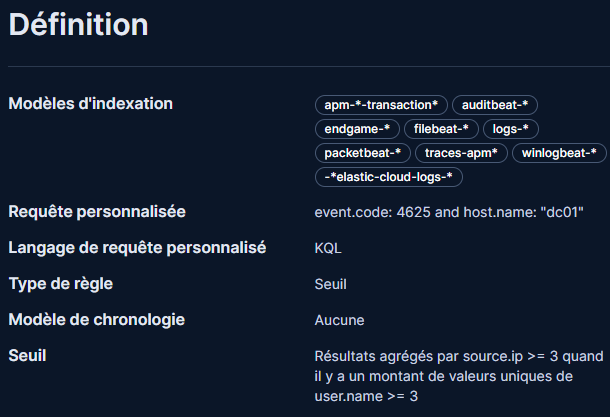
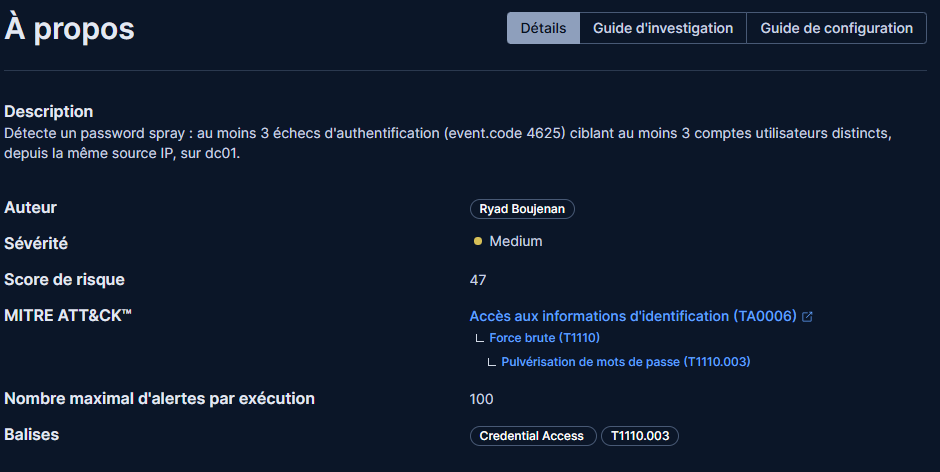
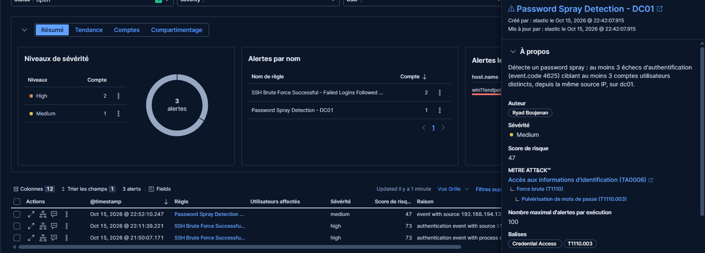
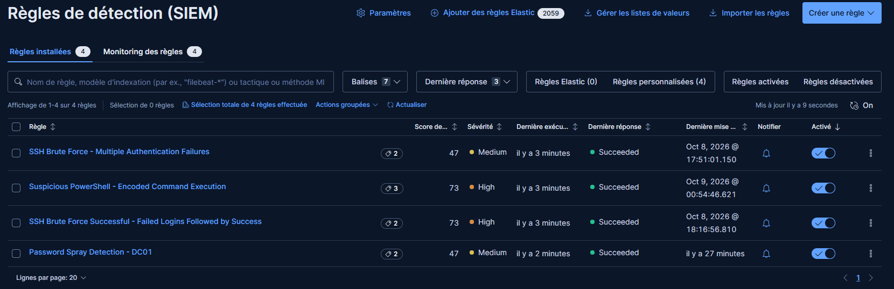

# Active Directory – Password Spray Detection

Scénario de détection d'une attaque de type *password spray* contre un Active Directory (Windows Server, DC01), avec Elastic Security (Kibana).

## Contexte

Un attaquant tente de s'authentifier sur plusieurs comptes de domaine différents depuis une même machine, en utilisant un petit nombre de mots de passe courants, afin d'éviter le verrouillage de compte déclenché par un brute force classique sur un seul utilisateur.

Dans ce lab, 3 tentatives d'authentification échouées sont simulées depuis un poste client Windows 11 (`WIN11ENDPOINT`) vers le contrôleur de domaine (`DC01`), en ciblant 3 comptes distincts (`svc-admin`, `bob`, `alice`).

## Environnement

- **Contrôleur de domaine** : Windows Server (DC01), logs de sécurité Windows collectés via Elastic Agent
- **Poste client** : Windows 11 Pro (WIN11ENDPOINT)
- **SIEM** : Elastic Security (Kibana)
- **Source de données** : Event ID 4625 (échec d'authentification) ingéré depuis les journaux d'événements Windows du DC

## Simulation de l'attaque

Depuis `WIN11ENDPOINT`, exécution de tentatives de connexion échouées vers le DC avec des comptes différents :

```powershell
net use \\dc01\c$ /user:domaine\svc-admin MauvaisMotDePasse1
net use \\dc01\c$ /user:domaine\bob MauvaisMotDePasse2
net use \\dc01\c$ /user:domaine\alice MauvaisMotDePasse3
```

Chaque commande échoue avec *"System error 86 — the specified network password is not correct"*, générant un événement 4625 sur le DC.



## Règle de détection

Une règle de type **Seuil (Threshold)** a été créée dans Elastic Security pour détecter ce pattern.

**Requête personnalisée (KQL) :*
**Logique de détection :** résultats agrégés par `source.ip`, déclenchée si au moins **3 échecs** proviennent de la même source **et** ciblent au moins **3 comptes utilisateurs distincts** (`user.name`) — c'est cette double condition (volume + diversité des comptes) qui distingue un password spray d'un simple brute force sur un compte unique.

**Planification :** exécution toutes les 5 minutes, avec 1 minute de récupération supplémentaire.



## Classification et scoring

| Champ | Valeur |
|---|---|
| Sévérité | Medium |
| Score de risque | 47 |
| Tactique MITRE ATT&CK | Credential Access (TA0006) |
| Technique | Brute Force (T1110) |
| Sous-technique | Password Spraying (T1110.003) |



## Résultat

La règle a détecté l'attaque simulée et généré une alerte en moins d'un cycle d'exécution (5 minutes), visible dans Security → Détections.



Ce scénario s'ajoute aux règles déjà en place dans ce lab (SSH brute force, exécution PowerShell suspecte), formant un ensemble de détections couvrant plusieurs vecteurs d'attaque courants.



## Pistes d'investigation (guide analyste)

1. Identifier la source (`source.ip` / nom de la machine) et vérifier si elle est légitime (poste connu, VPN, etc.)
2. Lister les comptes ciblés — un pattern touchant des comptes à privilèges (ex: `svc-admin`) est un signal fort
3. Vérifier si l'un des comptes ciblés a fini par s'authentifier avec succès (Event ID 4624) juste après — indicateur de compromission
4. Si confirmé : isoler la machine source, forcer la réinitialisation des mots de passe des comptes ciblés
